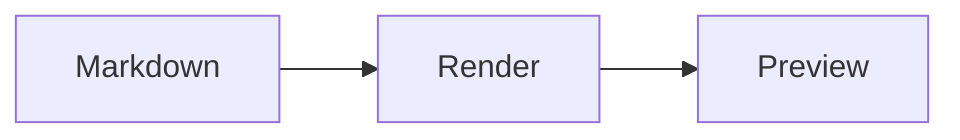

# GitHub README rendering baseline

This synthetic document checks Markdown rendering. 中文段落用于检查中英文混排、标点和自动换行。

## Text and headings

Plain text, **bold**, *italic*, ~~strikethrough~~, `inline_code()`, [a link](https://github.com/), and an escaped asterisk: \*.

This is a soft line break.
It continues in the same paragraph.

This is a hard line break.  
It starts on a new rendered line.

### Heading level 3

#### Heading level 4

##### Heading level 5

###### Heading level 6

## Lists

- First item
  - Nested item with **bold** and `code`
  - Another nested item
- Second item

1. Ordered item
2. Another item
   1. Nested ordered item

- [ ] Pending task
- [x] Completed task

## Quotes and alerts

> Ordinary quote with a second paragraph.
>
> Second paragraph with a [link](https://github.com/).
>
> > Nested quote.

> [!NOTE]
> A note with **bold** text.

> [!TIP]
> A helpful tip.

> [!IMPORTANT]
> Important information.

> [!WARNING]
> A warning.

> [!CAUTION]
> A caution.

## Tables

| Left | Center | Right |
| :--- | :---: | ---: |
| Short | **Bold** | 123 |
| Longer content in a table cell | `inline_code()` | 456 |

| Unbreakable | Value |
| --- | --- |
| a_very_long_unbreakable_identifier_that_checks_horizontal_overflow_in_a_narrow_reading_panel | 42 |

## Code

```typescript
const message: string = 'hello';
function greet(name: string) {
  return `${message}, ${name}`;
}
console.log(greet('reader'));
```

```python
def square(value):
    # A comment and a number
    return value ** 2

print(square(42))
```

```json
{"enabled": true, "count": 42, "items": ["first", "second"]}
```

```
An unlabelled code block.
Another line.
```

```text
one_very_long_code_line_for_horizontal_overflow_abcdefghijklmnopqrstuvwxyz_abcdefghijklmnopqrstuvwxyz_abcdefghijklmnopqrstuvwxyz_abcdefghijklmnopqrstuvwxyz
```

## Images and HTML


<details>
<summary>Collapsed details with Markdown</summary>

**Expanded content** with a list:

- First detail
- Second detail

</details>

<kbd>Ctrl</kbd> + <kbd>Shift</kbd> + <kbd>P</kbd>

<p align="center">Centered HTML paragraph.</p>

<!-- This comment must not appear in GitHub Preview. -->

## Footnotes

A sentence with a footnote.[^example] A repeated reference.[^example]

[^example]: Footnote text with **bold** and a [link](https://github.com/).

## Math

Inline formula: $x^2 + y^2 = z^2$.

$$
\sum_{i=1}^{n} i = \frac{n(n+1)}{2}
$$

```math
\begin{pmatrix} a & b \\ c & d \end{pmatrix}
```

## Mermaid



## Duplicate heading

First occurrence.

## Duplicate heading

Second occurrence.

---

End of the synthetic baseline.
