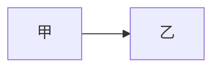
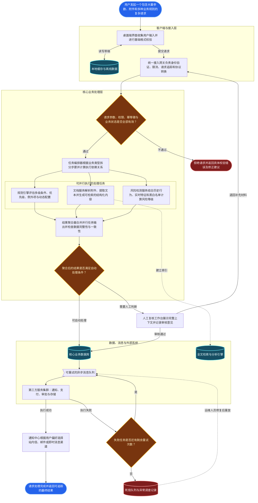
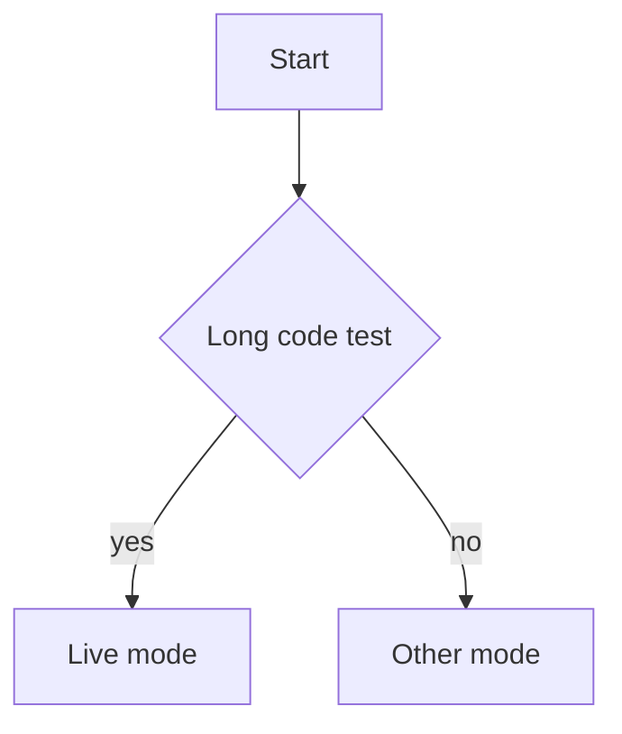
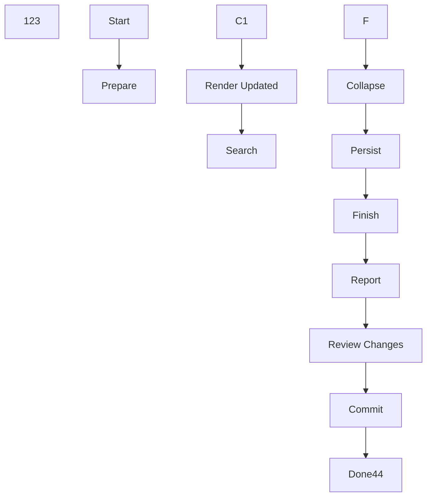
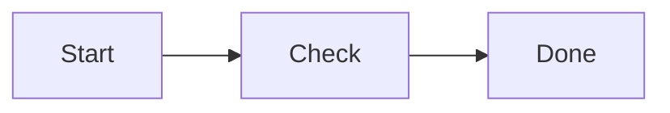
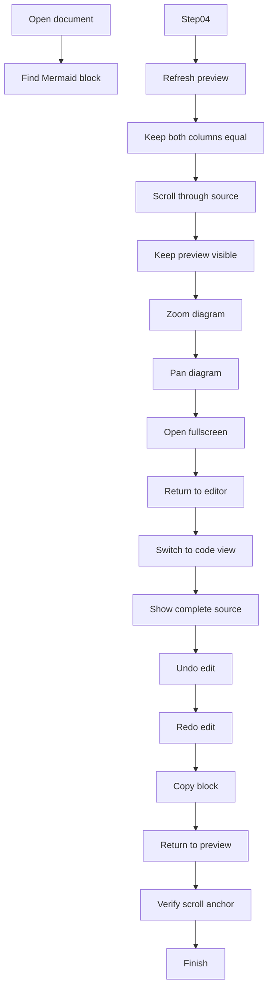
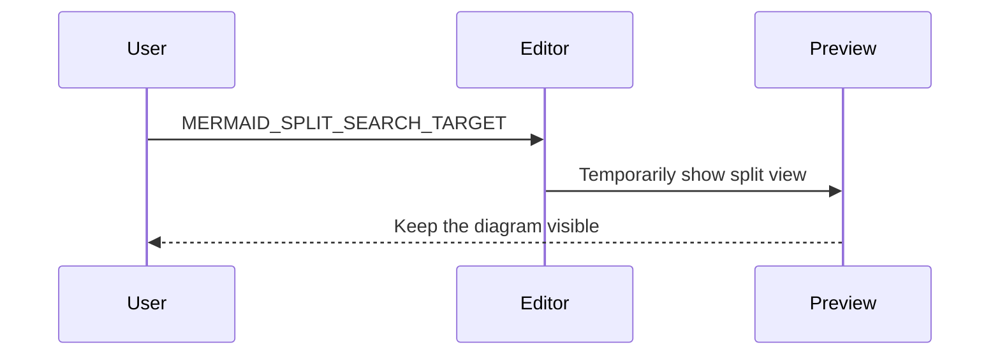
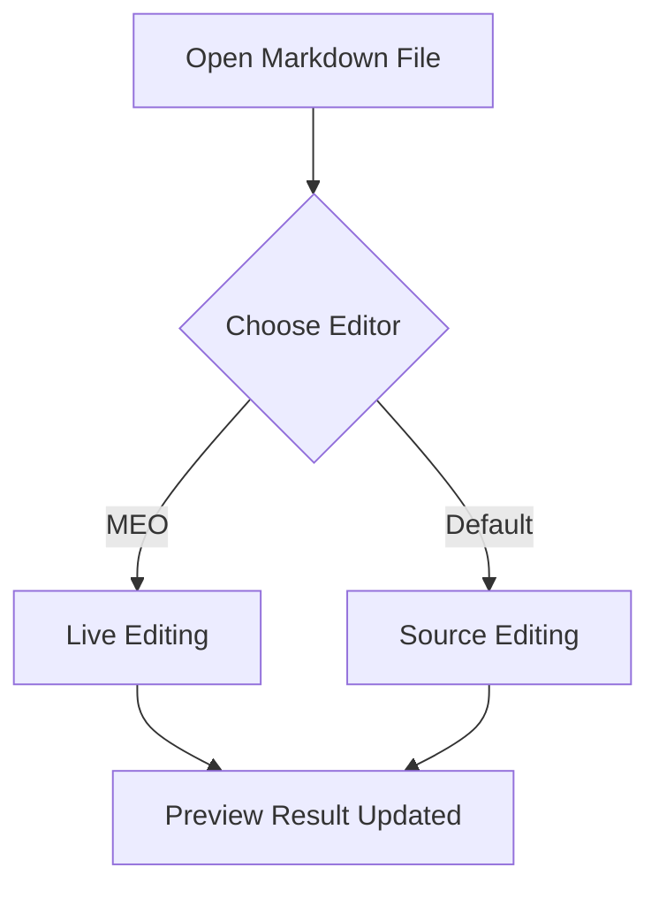
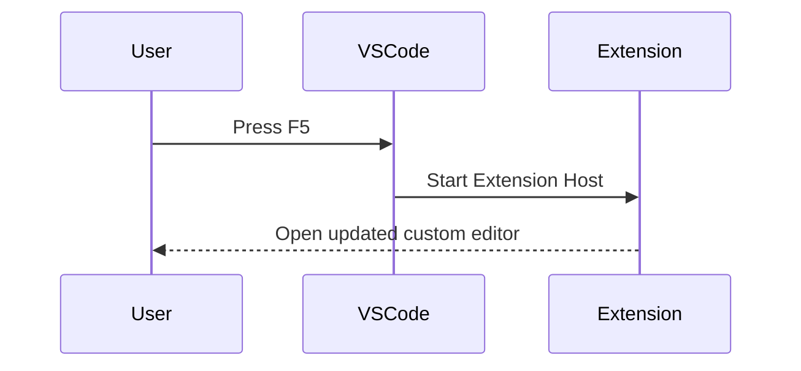

# 复合内容样式巡检 · Preview / Live

<!-- meo-composite-style-audit:start -->

切换 Preview / Live，对照相同编号。Live 中分别观察光标移开与进入块后的表现；在宽窗口与窄窗口下检查缩进、边线、留白、折行与容器边界。后方保留原有测试内容。

## S01 · 单块参照

普通段落：**重点**、*说明*、~~过期~~、`inline-code`、[链接](https://example.com) 与行内公式 $a^2+b^2=c^2$。

- 普通项目
- [ ] 未完成任务
- [x] 已完成任务

1. 有序项目甲
2. 有序项目乙

> 一级引用。
>
> > 二级引用：检查两条边线的间距和文字起点。

| 项目 | 内容 | 状态 |
| :--- | :--- | :---: |
| 基线 | **重点**、`code`、$x+y$ | 已完成 |
| 长内容 | 检查表头、行高和自然折行。 | 待观察 |


$$
E=mc^2 \qquad f(x)=\frac{x^2+1}{x+1}
$$

## S02 · 列表 × 多段正文 × 二级引用

- 项目甲：首行含 **重点** 和 $p=\frac{a}{b}$。

  同一项目的第二段，应保持列表正文的起点。

  > 列表中的一级引用。
  >
  > > 二级引用，含 `inline-code`。
  > >
  > > - [ ] 内层待办
  > > - [x] 内层已完成项

  引用结束后仍属于项目甲的正文。

- 项目乙：检查边线是否在这里结束。

## S03 · 引用 × 有序 / 无序 / 任务列表

> 引用开头的解释段落。
>
> 1. 第一阶段
>    - 无序子项
>    - [ ] 待办子项，含 **重点** 和 $x_1+x_2$。
> 2. 第二阶段
>    > 阶段内的补充引用。
>    >
>    > - [x] 补充引用内的已完成项
>
> 引用末尾，应与开头保持相同正文起点。

普通正文：引用背景和边线应已经结束。

## S04 · 列表 × 表格 × 续段

1. 第一项：表格应属于该列表项。

   | 检查项 | 内容 | 状态 |
   | :--- | :--- | :---: |
   | 基线 | **粗体**、`code`、$\alpha+\beta$ | 通过 |
   | 长内容 | 这段内容故意稍长，检查表格在列表缩进后如何利用剩余宽度以及是否自然折行。 | 待查 |

   表格后续段，应与第一项正文对齐。

2. 第二项：检查序号是否继续。

- [ ] 任务项中的表格

  | 操作 | 反馈 |
  | :--- | :--- |
  | 勾选任务 | 列表标记和表格边界应保持清楚 |

  任务项中的续段。

## S05 · 一级 / 二级引用 × 表格

> 一级引用中的表格。
>
> | 项目 | 内容 |
> | :--- | :--- |
> | 一级 | 引用边线应覆盖表格区域 |
> | 行内格式 | **重点**、`code`、$a+b$ |
>
> > 二级引用中的表格。
> >
> > | 项目 | 内容 |
> > | :--- | :--- |
> > | 二级 | 两层引用边线与表格边框同时存在 |
> > | 长内容 | 检查宽度减少后是否拥挤，右侧边界是否完整可见。 |
> >
> > 内层表格后的解释。
>
> 外层引用的收尾。

## S06 · 列表 × Mermaid

1. 项目内部的处理流程。

   ```mermaid
   flowchart LR
     A[输入] --> B{检查}
     B -->|通过| C[显示]
     B -->|失败| D[提示]
   ```

   图后续段：观察图与列表正文的对齐和留白。

2. 后续项目：检查列表是否连续。

## S07 · 一级 / 二级引用 × Mermaid

> 一级引用中的图。
>
> ```mermaid
> flowchart LR
>   A[起点] --> B[中间] --> C[终点]
> ```
>
> > 二级引用中的图。
> >
> > ```mermaid
> > flowchart TD
> >   A[父节点] --> B[子节点甲]
> >   A --> C[子节点乙]
> > ```
> >
> > 图后说明：检查边线是否连续，图是否越过自己的容器。
>
> 外层引用收尾。

## S08 · 列表 / 引用 × 公式块

- 列表内公式：

  $$
  S_n=\sum_{k=1}^{n}k=\frac{n(n+1)}{2}
  $$

  公式后的正文仍属于本项目。

> 一级引用内公式：
>
> $$
> \begin{aligned}
> a+b &= c \\
> a-b &= d
> \end{aligned}
> $$
>
> > 二级引用内公式：
> >
> > $$
> > P(A\mid B)=\frac{P(B\mid A)P(A)}{P(B)}
> > $$
> >
> > 内层说明：检查公式居中、留白和边线。

## S09 · 引用 × 列表 × 表格 / 图 / 公式

> 一个真实文档式的复合流程。
>
> 1. 查看数据。
>
>    | 指标 | 数值 | 说明 |
>    | :--- | ---: | :--- |
>    | 样本数 | 24 | `count` |
>    | 通过数 | 21 | **可读性检查** |
>
> 2. 查看流程。
>
>    ```mermaid
>    flowchart LR
>      A[采集] --> B[检查] --> C[汇总]
>    ```
>
> 3. 查看计算。
>
>    $$
>    r=\frac{21}{24}\times100\%=87.5\%
>    $$
>
>    - [ ] 复核子块的共同缩进
>    - [x] 记录完成状态
>
> 引用末尾：检查所有子块是否被外层容器完整包住。

## S10 · 二级引用 × 列表 × 代码 / 表格

> 外层说明。
>
> > 内层说明。
> >
> > - **项目甲**：包含代码。
> >
> >   ```json
> >   { "mode": "live", "nested": true }
> >   ```
> >
> >   代码后的同项正文。
> >
> > - **项目乙**：包含表格。
> >
> >   | 标记 | 说明 |
> >   | :--- | :--- |
> >   | `> > -` | 二级引用中的列表 |
> >   | $x^2$ | 单元格内的公式 |
> >
> >   表格后的同项正文。

## S11 · 表格单元格 × 复合内容

以下单元格用 `<br>` 换行。整块图与多行公式的标准嵌套用例见前面各节。

| 组合 | 示例内容 | 观察点 |
| :--- | :--- | :--- |
| 列表与引用 | - 项目甲<br>- > 补充引用 | 标记、边线和正文起点 |
| 二级引用与任务 | > 外层<br>> > - [ ] 内层待办<br>> > - [x] 内层完成 | 层级与勾选框 |
| 连续列表标记 | - 1. [ ] 同行复合待办 | 圆点、序号、勾选框是否拥挤 |
| 行内格式 | **重点**、~~过期~~、`very-long-inline-code-without-spaces`、$\frac{a+b}{c}$ | 基线、折行和横向溢出 |

## S12 · 长内容 / 连续容器边界

> > - [ ] 这是故意拉长的二级引用待办项，包含 **较长的强调文本**、`long-inline-code-for-wrapping-check` 和 $x_1+x_2+\cdots+x_n$，观察续行是否对齐正文、边线是否连贯，以及勾选框是否仍然处于正确的视觉层级。
> > - 第二项，对照上一项的续行缩进。

> 普通引用紧接深层引用，检查层级回退。

- 列表中的引用结束后继续正文：
  > 引用正文。

  列表续段。
- 紧接的下一项目。

普通正文与 $a+b$。以下短公式和短图连续出现，检查块间距。

$$
x+y=1
$$



> 紧接图后的短引用。

| 项目 | 内容 |
| :--- | :--- |
| 收尾 | 表格紧接引用，观察上下间距 |

## S13 · 脚注引用 × 列表 / 引用 / 表格

普通正文的脚注[^audit-inline]，行内公式 $a+b$ 的说明[^audit-formula]。

- 列表正文中的脚注[^audit-inline]。
- [ ] 任务项中的脚注[^audit-task]。
  1. 有序子项复用脚注[^audit-inline]。

> 引用正文中的脚注[^audit-quote]。
>
> > - [x] 二级引用里的任务项也带脚注[^audit-task]。

| 位置 | 内容 | 说明 |
| :--- | :--- | :--- |
| 普通单元格 | **重点**、`code` 和脚注[^audit-table] | 标记不能被裁切 |
| 复合单元格 | > - [ ] 单元格内任务与脚注[^audit-task] | 标记与正文基线 |
| 重复引用 | 同一脚注[^audit-inline]再次出现 | 编号一致与返回位置 |

## S14 · 脚注定义 × 多段正文 / 混合列表 / 二级引用

这一段引用复合说明[^audit-structure]。检查脚注编号、续段起点与内部容器层级。

[^audit-structure]: 第一段定义，含 **强调**、`inline-code` 和 $x_1+x_2$。

    第二段定义，观察续段是否与正文对齐。

    1. 有序项目甲
       - 无序子项
       - [ ] 待办子项
    2. 有序项目乙

    > 脚注内的一级引用。
    >
    > > 脚注内的二级引用。
    > > - [x] 内层已完成项

    引用后的脚注续段。

## S15 · 脚注定义 × 表格 / Mermaid / 公式

这一段引用图表说明[^audit-blocks]。这三个块应保持脚注正文的共同起点。

[^audit-blocks]: 图表说明的开头。

    | 指标 | 数值 | 解释 |
    | :--- | ---: | :--- |
    | 样本 | 8 | `count` |
    | 通过 | 6 | **复核结果** |

    ```mermaid
    flowchart LR
      A[脚注数据] --> B[分析] --> C[说明]
    ```

    $$
    r=\frac{6}{8}\times100\%=75\%
    $$

    公式后的脚注续段。

## S16 · 脚注定义 × 列表 × 引用 / 表格 / 代码

三层脚注内容说明[^audit-deep]。

[^audit-deep]: 外层脚注说明。

    - 第一个列表项：包含引用。

      > 子引用的正文。
      >
      > | 项目 | 说明 |
      > | :--- | :--- |
      > | 子表格 | 应处于脚注、列表和引用的共同容器内 |

      引用之后的同项正文。

    - 第二个列表项：包含代码。

      ```json
      { "context": "footnote", "nested": true }
      ```

      代码之后的同项正文。

## S17 · 重复脚注 / 长说明 / 返回与边界

第一次引用[^audit-repeat]，第二次引用[^audit-repeat]，二级引用也复用同一个编号：

> > 再次引用[^audit-repeat]。

未定义脚注[^audit-missing]用于检查缺失定义的边界；代码里的 `[^audit-inline]` 应保持普通代码文字。

[^audit-repeat]: 这是故意拉长的脚注说明，包含 **较长的强调文字**、`long-inline-code-for-footnote-wrapping-check` 与 $x_1+x_2+\cdots+x_n$，用于检查窄窗口下编号与正文的间距、续行对齐、折行和返回入口。

    同一脚注的第二段，应继续保持正文起点。

[^audit-inline]: 普通说明；多次引用应共用编号。
[^audit-formula]: 公式的补充说明，含 $a^2+b^2=c^2$。
[^audit-task]: 任务项和表格单元格共享的说明。
[^audit-quote]: 引用里的补充说明。
[^audit-table]: 表格里的补充说明，含 **强调** 和 `code`。

普通正文收尾：检查脚注定义的编号或边线是否越过自己的边界。

<!-- meo-composite-style-audit:end -->

---

# Live 模式复合 Markdown 用例

@startuml
' abc
'abc
@enduml


> 逐项观察渲染、折行、缩进、勾选状态和表格单元格；本节后保留原有测试内容。

## 修复效果速览

> 把光标移开示例行，观察 Live 渲染；点回该行可对照原始 Markdown。每行都是独立用例，后面的「同一行连续标记」章节还有完整组合矩阵。

### 无序列表后接有序列表

- 1. 示例 A：无序在外，有序在内。

### 有序列表后接无序列表

1. - 示例 B：有序在外，无序在内。

### 同一行三个列表层级

- 1. - 示例 C：同一行的三个列表层级。

### 引用、列表与勾选框连续出现

> - 1. [ ] 示例 D：引用中的双层列表与未完成待办。

### 表格单元格里使用相同组合

| 组合 | Live 中应看到 |
| --- | --- |
| - 1. 单元格：圆点后接序号 | 两层列表，内容完整 |
| 1. - 单元格：序号后接圆点 | 两层列表，顺序相反 |
| > - 1. [x] 单元格：引用中的已完成项 | 引用边线、圆点、已完成勾选框 |

> 语法边界：`- [ ] 1. 内容` 中的 `1.` 属于待办正文，应保持为文字；`- 1. [ ] 内容` 则是内层有序待办项。

---

## 0. 同一行连续标记（重点）

> 每行的 A/B/C 编号是对照标签。重点检查后续标记是否保留正确样式、文字是否消失、光标所在行与 Live 显示是否一致。各组之间留空行，避免相邻列表干扰。

### A. 两种列表标记的顺序

- 1. A1 无序 → 有序（对应截图中的 `- 1. 内容`）

1. - A2 有序 → 无序

- - A3 无序 → 无序

1. 2. A4 有序 → 有序

* 1) A5 星号无序 → 括号有序

1) + A6 括号有序 → 加号无序

### B. 列表与引用的顺序

- > B1 无序 → 引用

> - B2 引用 → 无序

1. > B3 有序 → 引用

> 1. B4 引用 → 有序

> > - B5 双层引用 → 无序

### C. 勾选框与列表、引用同一行

- [ ] C1 无序 → 未完成勾选框

1. [x] C2 有序 → 已完成勾选框

- [ ] 1. C3 待办正文中的 `1.` 保留为文字

1. - [x] C4 有序 → 无序 → 已完成勾选框

- [~] > C5 待办正文中的 `>` 保留为文字

> - [ ] C6 引用 → 无序 → 勾选框

### D. 三层及更多连续标记

- 1. - D1 无序 → 有序 → 无序

1. - 2. D2 有序 → 无序 → 有序

> - 1. [ ] D3 引用 → 无序 → 有序 → 勾选框

- > 1. [x] D4 无序 → 引用 → 有序 → 勾选框

1. > - [ ] D5 有序 → 引用 → 无序 → 勾选框

- 1. - 2. [ ] D6 五段连续标记，后接 **粗体**、`代码` 和 [链接](https://example.com)

### E. 连续相邻行

- 1. E1 第一行无序 → 有序
1. - E2 第二行有序 → 无序
- > - [ ] E3 第三行无序 → 引用 → 无序任务项

### F. 勾选标记的生效位置

普通正文中的 [ ] 和 [x] 都保持文字。

- 列表正文写到一半的 [ ] 保持文字。

1. 有序列表正文写到一半的 [x] 保持文字。

> - 引用列表正文中的 [ ] 也保持文字。

- [ ] 真正的待办：方括号紧跟列表标记。

- 1. [ ] 复合待办：圆点、序号和勾选框都应可见。

| 普通单元格 | 列表正文 | 真正待办 |
| --- | --- | --- |
| 句中 [ ] 保持文字 | - 正文中的 [x] 保持文字 | - [ ] 开头的标记才是待办 |

## 1. 列表中的引用和勾选框

- 普通项目，含 **粗体**、*斜体*、`行内代码` 和 [链接](https://example.com)。
- 引用作为列表项的子块：
  > 引用第一行，含 **强调**。
  >
  > - 引用里的无序项
  > - [ ] 引用里的待办项
  >   1. 待办项下的有序子项
- [ ] 未完成事项
  - 子项目 A
  - [x] 已完成的子事项
- [x] 已完成事项

## 2. 引用中的列表与多层引用

> 引用段落，含 *斜体* 与 `代码`。
>
> 1. 第一项
>    - 无序子项
>    - [ ] 子待办
> 2. 第二项
>
> > 第二层引用
> > - [x] 已完成
> > - 普通项

## 3. 有序、无序、勾选框交错

1. 有序第一项
   - 无序子项
     1. 更深一级有序项
     2. 更深一级有序项，含 ~~删除线~~
   - [ ] 同级待办项
2. 有序第二项
   > 其下引用
   > - 引用中的列表

- [ ] > 同一行组合：待办项接引用标记
- > - [ ] 同一行组合：列表、引用、待办连续出现

## 4. 折行与连续段落

- 这是一个较长的列表项，包含 **加粗**、[链接](https://example.com/path?case=live-mode)、`inline-code-with-many-characters`，用于观察窗口变窄时的自动折行、标记位置与文字是否重叠。

  同一列表项的第二个段落。

  > 第二个段落后的引用。
  > - [ ] 引用中的待办。

## 5. 表格单元格中的组合标记

| 场景 | 内容 | 观察点 |
| --- | --- | --- |
| 行内格式 | **粗体**、*斜体*、`代码`、[链接](https://example.com) | 内容与列宽 |
| 换行加无序项 | 引导文字<br>- 第一项<br>- **第二项** | 换行、缩进、项目符号 |
| 换行加有序项 | 1. 第一项<br>2. 第二项<br>3) 第三项 | 序号样式 |
| 换行加勾选框 | - [ ] 未完成<br>- [x] 已完成<br>- [~] 进行中<br>- [-] 已放弃 | 状态图标与只读显示 |
| 换行加引用 | > 第一行引用<br>> **第二行引用** | 引用边线与折行 |
| 多种组合 | - [ ] 待办 **重点**<br>  1. 子项 `code`<br>  > 引用文字 | 嵌套层级和显示完整性 |
| 转义竖线 | `a \| b` 与普通文字 | 不应误拆列 |

### 5.1 表格单元格内的同一行连续标记

| 编号 | 单元格内容 | 检查项 |
| --- | --- | --- |
| T1 | - 1. 无序 → 有序 | 两个列表标记与文字 |
| T2 | 1. - 有序 → 无序 | 反向顺序 |
| T3 | > - 1. 引用 → 无序 → 有序 | 三段连续标记 |
| T4 | - 1. [ ] 无序 → 有序 → 勾选框 | 多种标记与状态 |
| T5 | 1. - [x] 有序 → 无序 → 已完成 | 反向顺序与状态 |
| T6 | - 1. 第一段<br>1. - 第二段 | 单元格内换行后的顺序变化 |

## 6. 引用和列表中的整张表格

> 引用里的表格：
>
> | 状态 | 说明 |
> | --- | --- |
> | [ ] 待办 | **引用内**的单元格 |
> | [x] 完成 | 第一行<br>第二行 |

- 列表里的表格：

  | 类型 | 内容 |
  | --- | --- |
  | 无序 | - 项目 A<br>- 项目 B |
  | 勾选 | - [ ] 待办<br>- [x] 完成 |

## 7. 语法边界

```markdown
- [ ] 代码块里的标记应保持原样
> 代码块里的引用标记应保持原样
| a | b |
```

段落里的 `- [ ]`、`> 引用` 和 `| 表格 |` 都是行内代码。

---

<!-- 原有测试内容从这里开始 -->

---
111: d55d565666999366777734
698: dioig2344

123: www.baidu.com
---


#22C55E / #F59E0B / #EF4444

| 类型 | 示例#EF4444 | 说明 |
| --- | --- | --- |
| 链接 | [Marketplace](https://marketplace.visualstudio.com/items?itemName=huangko555.meo-enhanced) | 打开外部页面 |
| 行内代码 | `code --install-extension huangko555.meo-enhanced` | 保留等宽字体 |
| 格式 | _**粗体**_、*斜体*、~~删除线~~、==高亮== | 常用行内格式 |
| 快捷键 | <kbd>Ctrl</kbd> + <kbd>S</kbd> | HTML 键盘标签 |
| 颜色 | #22C55E / #F59E0B / #EF4444 | 颜色值预览 |
| 多行 | 第一行<br>第二行<br>第三行 | 单元格内换行 |
| 图片 |  | 本地相对路径 |

### 长表格与固定表头


  ```javascript
  const nestedLongLine01 = 1;
  const nestedLongLine02 = 2;
  const nestedLongLine03 = 3;
  const nestedLongLine04 = 4;
  const nestedLongLine05 = 5;55555
  const nestedLongLine06 = 6;
  const nestedLongLine07 = 7;
  const nestedLongLine08 = 8;
  const nestedLongLine09 = 9;
  const nestedLongLine10 = 10;
  const nestedLongLine11 = 11;
  const nestedLongLine12 = 12;
  const nestedLongLine13 = 13;
  const nestedLongLine14 = 14;
  const nestedLongLine15 = 15;
  const nestedLongLine16 = 16;
  const nestedLongLine17 = 17;
  const nestedLongLine18 = 18;
  const nestedLongLine19 = 19;
  const nestedLongLine20 = 20;
  const nestedLongLine21 = 21;
  const nestedLongLine22 = 22;
  const nestedLongLine23 = 23;
  const nestedLongLine24 = 24;
  ```


| 类型 | | 类型 |  |  | 内容 | 备注 |
| --- | --- | --- | --- | --- |
|  |  |  |  |  |  |  |
|  |  |  |  |  |  |  |
| 链接 |  |  | [VS Code](https://code.visualstudio.com/) | #table/tag |
| 强调 |  |  | **粗体**、*斜体*、~~删除线~~ | `inline code` |
|  |  |  |  |  |  |  |
|  |  |  | 1 |  |
|  |  |  |  |  |  |  |
|  |  |  |  |  |  |  |
|  |  |  |  |  |  |  |
|  |  |  |  |  |  |  |
|  |  |  |  |  |  |  |
|  |  |  |  |  |多列表格

123


# HTML 内容渲染与交互测试区

> 目标：在 Live 模式中像普通正文一样显示安全 HTML，不出现代码块式背景；Source 模式始终保留原始源码；Preview 与导出结果应保持一致。111111111111455442442242424

HTML 测试区上方固定参照行：切换渲染/源码、点击链接或折叠内容时，本行不应在窗口中跳动。

<div id="html-test-top"></div>
65555

## HTML 1. 段落与对齐111111114242224244242424242466hai还

<p>没有 align 属性的普通段落：应继承正文对齐方式，通常保持左对齐。</p>

<p align="left">显式左对齐段落：Left aligned paragraph.</p>

<p align="center">显式居中段落：Centered paragraph，仅这一段居中。</p>

<p align="right">显式右对齐段落：Right aligned paragraph.</p>

<div>
  <p>普通 div 内的段落，不应出现卡片背景、边框、阴影或额外内边距。</p>
  <p align="center">同一个 div 中的第二段可以单独居中。</p>
</div>

## HTML 2. 行内样式与复杂嵌套11566666555555555555555555

<p>
  普通文字、<strong>粗体</strong>、<b>另一种粗体</b>、
  <em>斜体</em>、<i>另一种斜体</i>、
  <del>删除线</del>、<s>另一种删除线</s>、
  <mark>高亮文字</mark>、<code>const inline = true</code>、
  <kbd>Ctrl</kbd> + <kbd>Shift</kbd> + <kbd>V</kbd>、
  H<sub>2</sub>O、x<sup>2</sup>。
</p>

<p>
  <strong>粗体中包含 <em>斜体</em>、<mark>高亮</mark> 和 <code>inline code</code></strong>；
  <em>斜体中包含 <del>删除内容</del> 和 <kbd>Enter</kbd></em>；
  <span title="这是 span 的 title">带 title 的 span 文本</span>。
</p>

<p>
  第一行通过 br 结束。<br>
  第二行包含 <strong><em><mark>粗体、斜体和高亮的三层嵌套</mark></em></strong>。<br>
  第三行用于检查换行后的行高和光标定位。
</p>

## HTML 3. 链接、跳转图标与目标定位

<p>
  <a href="#html-jump-target" title="跳转到本测试区下方">文档内锚点</a> ·
  <a href="./markdown-render-test.md#html-jump-target" title="打开当前文件并跳转">相对文件锚点</a> ·
  <a href="https://example.com" title="外部示例链接">外部链接</a>
</p>

<p>
  每个链接后应始终显示对应的跳转图标；点击图标应执行跳转，普通点击文字不应突然展开整个 HTML 块或移动窗口。
</p>

链接跳转前固定参照行 01。
链接跳转前固定参照行 02。

<div id="html-jump-target">
  <p><strong>HTML 文档内跳转目标：</strong>跳转到这里时应保持 HTML 为渲染状态，并把目标稳定地带入视口。</p>
</div>

链接跳转后固定参照行 01。
链接跳转后固定参照行 02。

## HTML 4. 图片与嵌套链接

<p align="center">
  <a href="assets/screenshot-1785549139805.svg" title="打开本地图片">
    
  </a>
  <br>
  <strong>居中的 HTML 图片及说明文字</strong>
</p>

<p>图片应复用现有查看、缩放和全屏能力；HTML 源码编辑不应破坏图片链接。</p>

## HTML 5. Details / Summary 与内部富文本5554444666

<details>
  <summary><strong>默认折叠：</strong>summary 内包含粗体和 <kbd>Enter</kbd></summary>
  <p>折叠正文第一段，包含 <a href="#html-test-top">返回 HTML 测试区顶部</a>。</p>
  <p>折叠正文第二段，包含 <mark>高亮</mark>、<em>斜体</em>和<del>删除线</del>。</p>
</details>

<details open>
  <summary><strong>默认展开：</strong>反复折叠、编辑源码并退出</summary>
  <div>
    <p>多层结构第一段：展开和折叠时，下方固定参照行应保持稳定。</p>
    <p align="right">多层结构第二段：仅本段右对齐。</p>
  </div>
</details>

Details 下方固定参照行 01。6666
Details 下方固定参照行 02。66611111

## HTML 6. HTML 列表、引用与表格（第二批观察）5566

<blockquote>
  <p><strong>HTML 引用：</strong>用于观察它是否能复用 Markdown 引用的排版，而不是显示为独立卡片。</p>
</blockquote>

<ul>
  <li>无序列表第一项，包含 <strong>粗体</strong>。</li>
  <li>无序列表第二项，包含 <a href="#html-jump-target">锚点链接</a>。</li>
  <li>无序列表第三项。
    <ol>
      <li>嵌套有序列表第一项。</li>
      <li>嵌套有序列表第二项，包含 <code>inline code</code>。</li>
    </ol>
  </li>
</ul>

<table>
  <thead>
    <tr>
      <th>HTML 类型</th>
      <th>预期表现</th>
      <th>交互</th>
    </tr>
  </thead>
  <tbody>
    <tr>
      <td><strong>行内样式</strong></td>
      <td>嵌入普通文字</td>
      <td>当前行编辑</td>
    </tr>
    <tr>
      <td><a href="#html-jump-target">链接</a></td>
      <td>始终显示跳转图标</td>
      <td>图标点击跳转</td>
    </tr>
    <tr>
      <td><mark>块级 HTML</mark></td>
      <td>无卡片背景</td>
      <td>源码按钮编辑</td>
    </tr>
  </tbody>
</table>

## HTML 7. 多行源码、行号与 Changes 观察

多行 HTML 上方固定参照行 01。
多行 HTML 上方固定参照行 02。

<div id="html-multiline-block">
  <p>
    这是一个跨越多行源码的 HTML 块。
    <strong>进入源码时应显示每一个真实行号，退出后恢复文档流渲染。</strong>
  </p>
  <p>
    修改这一行、增加一行或删除一行后，观察红蓝绿色 Changes 标记是否正确聚合与展开。
  </p>
  <p align="center">
    最后一段用于观察源码和渲染高度变化时的视口保持。
  </p>
</div>

多行 HTML 下方固定参照行 01。
多行 HTML 下方固定参照行 02。

## HTML 8. 属性过滤与兼容性观察

<p id="html-safe-attributes" title="允许的 title 属性" align="center">
  应保留 id、title 和受控 align 属性。
</p>

<p style="color: red" onclick="return false">
  安全回退测试：任意 style 和 onclick 不应执行，也不应覆盖编辑器布局；正文内容仍应可见。
</p>

<section data-example="unsupported-section">
  <p>未列入首批范围的 section：若不能安全渲染，应保留源码并显示非阻塞警告，不能静默丢失正文。</p>
</section>

## HTML 9. 注释显示与导出

> Live 应渲染安全 HTML 正文，所有注释原样显示为 `<!-- ... -->`，统一使用注释语法颜色与斜体，不加标签、底色或边框。HTML 块外的注释可直接点击编辑；块内的注释点击后定位到对应源码。Source 始终显示原文；Preview 的“显示注释”默认关闭，开启后显示带 `<!-- ... -->` 原始标记的注释，不加翻译前缀或外框。HTML 容器中正文与注释相邻时，Live 与 Preview 的注释前后间距应接近，约各 0.4em；Preview 独立块注释前后保持相同间距。分别导出 HTML、PDF、DOCX，对照当前 Preview 的显示状态。

### 独立块注释

这段正文始终可见，下面的注释用于说明内部写作意图。

<!-- 独立块注释：这里是给作者的草稿说明，不属于正文。 -->

这段正文也应始终可见。

### 句中注释

发布说明已经写好<!-- 句中注释：上线前再核对日期。 -->，可以继续阅读后半句。

### HTML 容器中的两条注释

<div>
  <p>容器正文第一段：注释开关不应影响这段文字。</p>
  <!-- 容器注释一：检查段落之间的位置。 -->
  <p>容器正文第二段：两条注释之间的正文仍然可见。</p>
  <!-- 容器注释二：检查多个注释能否分别显示或隐藏。 -->
</div>

### 代码与转义文字对照

下面的代码示例和转义文字是正文内容，无论开关状态如何都应可见：

```html
<!-- 代码示例：这是示例文本，不是文档注释。 -->
```

&lt;!-- 转义示例：这也是正文文字。 --&gt;

HTML 测试区结束固定锚点：上方任何 HTML 进入或退出源码时，本行应尽量保持在原来的屏幕位置。

---

# MEO 交互与视口稳定性测试区


> 测试建议：先把“视口固定锚点”滚动到窗口上部，再操作它附近或上方的内容。操作后，锚点文字应尽量停留在原来的屏幕位置。
> 65565+6

## 1. Details / Summary 折叠与编辑

折叠区之前的固定参照行 01
折叠区之前的固定参照行 02
折叠区之前的固定参照行 03

<details>
<summary>默认折叠：点击展开后观察下方锚点</summary>

折叠正文第 01 行：用于制造高度变化。
折叠正文第 02 行：展开时内容应向下出现。
折叠正文第 03 行：折叠时不应产生无关跳动。
折叠正文第 04 行：可以在这里编辑并保存。
折叠正文第 05 行：也可以删除整个 details 块。
折叠正文第 06 行：观察窗口内原有内容的位置。

</details>

<details open>
<summary>默认展开：反复折叠、展开、编辑或删除</summary>

展开正文第 01 行：测试折叠后的高度收缩。
展开正文第 02 行：测试重新展开后的高度恢复。
展开正文第 03 行：测试 summary 文本编辑。
展开正文第 04 行：测试保存前后的视口稳定。
展开正文第 05 行：测试删除块时的内容方向。
展开正文第 06 行：这是一条额外高度行。

</details>

**Details 下方固定锚点 A：操作上面的折叠区时，尽量保持我在屏幕中的位置。**

锚点 A 后续参照行 01
锚点 A 后续参照行 02
锚点 A 后续参照行 03

## 2. 引用标记删除与长行换行

> 先把光标放到本行开头的 `>` 后面，再按 Backspace 删除引用标记。This is a deliberately long quoted line used to trigger wrapping and Live-mode decoration changes. 删除引用标记后，本行可能重新换行，但窗口中的其他稳定内容不应突然整体跳动。继续补充一些文字以确保在较窄窗口中形成多行布局：alpha beta gamma delta epsilon zeta eta theta iota kappa lambda.

> 第一层引用：删除最前面的 `>` 测试样式切换。
>
>> 第二层引用：逐个删除两个 `>` 测试嵌套引用变化。
>> **带有粗体的引用**：编辑标记并保存，观察视口位置。
>>
>
> 空引用行：删除 `>` 后应变成普通空行。

**引用区下方固定锚点 B：删除上方的 `>` 时，尽量保持我在屏幕中的位置。**

锚点 B 后续参照行 01
锚点 B 后续参照行 02
锚点 B 后续参照行 03

## 3. Live 表格编辑与高度变化


| 项目  | 短内容 | 长内容（编辑此列以制造换行和高度变化）                                                                           |
| ------- | -------- | ------------------------------------------------------------------------------------------------------------------ |
| Alpha | A1     | 这是一段较长的单元格文本。进入编辑状态后继续输入内容，观察表格本身是否保持在原处，以及新增高度是否主要向下增长。 |
| Beta  | B1     | 删除这段文字的一部分，再保存，检查表格退出编辑状态时是否发生窗口跳动。                                           |
| Gamma | C1     | **粗体内容**、`inline code` 与 [示例链接](https://example.com) 可用于测试单元格预览和编辑切换。                  |
| Delta | D1     | 在此处输入多行内容，测试 textarea 高度改变时的稳定性。                                                           |

**表格下方固定锚点 C：编辑上方表格时，表格应原地变化，新增高度应向下延伸。**

锚点 C 后续参照行 01
锚点 C 后续参照行 02
锚点 C 后续参照行 03

## 4. 过长代码块折叠开关

在工具栏 More 菜单中切换 **Fold Long Code Blocks**：默认应折叠；关闭开关后应显示完整代码且不出现折叠控件；重新开启后恢复折叠能力。

```typescript
const viewportCase01 = 'line 01';
const viewportCase02 = 'line 02';
const viewportCase03 = 'line 03';
const viewportCase04 = 'line 04';
const viewportCase05 = 'line 05';
const viewportCase06 = 'line 06';
const viewportCase07 = 'line 07';
const viewportCase08 = 'line 08';
const viewportCase09 = 'line 09';
const viewportCase10 = 'line 10';
const viewportCase11 = 'line 11';
const viewportCase12 = 'line 12';
const viewportCase13 = 'line 13';
const viewportCase14 = 'line 14';
const viewportCase15 = 'line 15';
const viewportCase16 = 'line 16';
const viewportCase17 = 'line 17';
const viewportCase18 = 'line 18';
const viewportCase19 = 'line 19';
const viewportCase20 = 'line 20';
const viewportCase21 = 'line 21';
const viewportCase22 = 'line 22';
const viewportCase23 = 'line 23';
const viewportCase24 = 'line 24';
const viewportCase25 = 'line 25';
const viewportCase26 = 'line 26';
const viewportCase27 = 'line 27';
const viewportCase28 = 'line 28';
```

**长代码块下方固定锚点 D：展开、折叠或关闭功能时，观察我是否无故跳动。**

## 5. 连续编辑与保存参照区

在下面各行中间或开头连续输入、删除、撤销、重做并保存；当前编辑行已经可见时，不应为了再次显示光标而轻微推动整个窗口。

- 编辑参照行 01：普通文本。
- 编辑参照行 02：包含 **粗体**、*斜体* 和 ~~删除线~~。
- 编辑参照行 03：包含 `行内代码` 与 [链接](https://example.com/docs)。
- 编辑参照行 04：可以在行首插入或删除标题、列表、引用标记。
- 编辑参照行 05：保存前后继续观察固定锚点。

**测试区结束固定锚点 E：下面开始保留原文件的全部既有内容。**

---

## 复杂 Mermaid 布局与长文字换行测试



# 列表内块级元素缩进测试

## 22

### 2225555

#### 444

##### 4444

- 一级列表：短代码块应整体向右缩进，右边界仍与正文区域对齐。

  ```javascript
  const nestedShortCode = '一级列表';
  console.log(nestedShortCode);
  ```


  | Markdown      | Example                        |
  | --------------- | -------------------------------- |
  | Inline code   | `const x = 1`                  |
  | Link          | [example](https://example.com) |
  | Strike        | ~~old value~~                  |
  | Bold + italic | **bold** and *italic*          |
  | Tag           | #table/tag                     |
- 一级列表：长代码块应带有位置正确的 Show more、Show less 和浮动 Show less。

  ```javascript
  const nestedLongLine01 = 1;
  const nestedLongLine02 = 2;
  const nestedLongLine03 = 3;
  const nestedLongLine04 = 4;
  const nestedLongLine05 = 5;55555
  const nestedLongLine06 = 6;
  const nestedLongLine07 = 7;
  const nestedLongLine08 = 8;
  const nestedLongLine09 = 9;
  const nestedLongLine10 = 10;
  const nestedLongLine11 = 11;
  const nestedLongLine12 = 12;
  const nestedLongLine13 = 13;
  const nestedLongLine14 = 14;
  const nestedLongLine15 = 15;
  const nestedLongLine16 = 16;
  const nestedLongLine17 = 17;
  const nestedLongLine18 = 18;
  const nestedLongLine19 = 19;
  const nestedLongLine20 = 20;
  const nestedLongLine21 = 21;
  const nestedLongLine22 = 22;
  const nestedLongLine23 = 23;
  const nestedLongLine24 = 24;
  ```


  | Markdown      | Example                        |
  | --------------- | -------------------------------- |
  | Inline code   | `const x = 1`                  |
  | Link          | [example](https://example.com) |
  | Strike        | ~~old value~~                  |
  | Bold + italic | **bold** and *italic*          |
  | Tag           | #table/tag                     |
- 一级列表：Mermaid 应保持相同缩进，切换编辑状态后位置不变。

  ```mermaid
  flowchart LR
    A[列表项列表项列表项列表项列表项] --> B[Mermaid55555]
    B --> C[保持缩进]
  ```
- 一级列表：块级公式应保持相同缩进，切换编辑状态后位置不变。

  $$
  \sum_{i=1}^{n} i = \frac{n(n+1)}{2}

  $$

  - 二级列表：下面的块应比一级列表再向右缩进一层。1

    ```javascript
    const secondLevelBlock = '二级列表';
    console.log(secondLevelBlock);
    ```


    | Markdown      | Example                        |
    | --------------- | -------------------------------- |
    | Inline code   | `const x = 1`                  |
    | Link          | [example](https://example.com) |
    | Strike        | ~~old value~~                  |
    | Bold + italic | **bold** and *italic*          |
    | Tag           | #table/tag  555                   |


    $$
    E = mc^255555555

    $$

---

---

多个行内公式：$a^2 + b^2 = c^2$，$\alpha + \beta = \gamma$。
------------------------------------------------------------



块级公式：

$$
\int_{-\infty}^{\infty} e^{-x^2}\,dx = \sqrt{\pi}

$$

# Live 长代码块折叠测试

下面的 JavaScript 代码块超过 18 行，Live 模式下默认保留前 10 行，其余内容可以手动展开；点击代码内容也会展开。5555

```javascript
const longLine01 = 1;
const longLine02 = 2;
const longLine03 = 3;
const longLine04 = 4;
const longLine05 = 5;
const longLine06 = 6;
const longLine07 = 7;
const longLine08 = 8;
const longLine09 = 9;
const longLine10 = 10;
const longLine11 = 11;
const longLine12 = 12;
const longLine13 = 13;
const longLine14 = 14;
const longLine15 = 15;
const longLine16 = 16;
const longLine17 = 17;
const longLine18 = 18;
const longLine19 = 19;
const longLine20 = 20;
const longLine21 = 21;
```

```
1231
3221
3232
```

搜索 `longLine19` 时，Live 模式应自动展开这个代码块；切换到其他代码块的搜索结果后，

---

title: Frontmatter Properties 渲染测试
aliases: [Properties Test, YAML Test]
tags: [Markdown, Editor, Frontmatter, 中文标签]
date: 2026-07-24
draft: false
rating: 4.54444444444444444444444444444441111111111111111111111
rating11111111111114444444444444444444444444441: 4.5444
rating111111111111: 4.5444444444444444444444444444444444444444444444444444444444444444444444441111111
homepage: https://example.com/docs, jj
"a:b": 带冒号的引号键
metadata:
  author: Example Author
  category: 测试文档
  nested:
    enabled: true123123
    level: 2
summary: >
  这是一段折叠块标量，用于测试 Preview 中复杂 YAML 的原文保留。
  第二行仍然属于 summary 字段。
notes: |
  Keep: this colon as literal block content.
  保留缩进、冒号：以及普通文本。
links:

- https://example.com/first
- label: Documentation
  url: https://example.com/second
  emptyValue:
  nullValue: null

---

1111

22222
3333331212121
454
11
444444
555555
1112 [Markdown, Editor, Frontmatter, 中文标签]
555
555

<!-- MEO_LONG_CODE_BLOCK_TEST_START -->

## 10. HTML

<details>
<summary>点击展开 details</summary>

这里是折叠内容。

- 支持 Markdown 列表
- 支持 `inline code`

</details>

<mark>highlight text</mark>

<sub>subscript</sub> and <sup>superscript</sup>

<blockquote>
  <p>HTML blockquote text with <strong>bold</strong> and <code>code</code>.</p>
</blockquote>

<table>
  <tr>
    <th>HTML Table</th>
    <th>Value</th>
  </tr>
  <tr>
    <td>tag text</td>
    <td><span>#html/tag</span></td>
  </tr>
</table>

行内公式：$E = mc^2$

多个行内公式：$a^2 + b^2 = c^2$，$\alpha + \beta = \gamma$。

块级公式：

$$
\int_{-\infty}^{\infty} e^{-x^2}\,dx = \sqrt{\pi}

$$

# Live 长代码块折叠测试

下面的 JavaScript 代码块超过 18 行，Live 模式下默认保留前 10 行，其余内容可以手动展开；点击代码内容也会展开。

```javascript
const longLine01 = 1;
const longLine02 = 2;
const longLine03 = 3;
const longLine04 = 4;
const longLine05 = 5;
const longLine06 = 6;
const longLine07 = 7;
const longLine08 = 8;
const longLine09 = 9;
const longLine10 = 10;
const longLine11 = 11;
const longLine12 = 12;
const longLine13 = 13;
const longLine14 = 14;
const longLine15 = 15;
const longLine16 = 16;
const longLine17 = 17;
const longLine18 = 18;
const longLine19 = 19;
const longLine20 = 20;
const longLine21 = 21;
```

搜索 `longLine19` 时，Live 模式应自动展开这个代码块；切换到其他代码块的搜索结果后，临时展开状态会收起。

下面这个无语言代码块即使超过 18 行也不应折叠：

```
plain line 01
plain line 02
plain line 03
plain line 04
plain line 05
plain line 06
plain line 07
plain line 08
plain line 09
plain line 10
plain line 11
plain line 12
plain line 13
plain line 14
plain line 15
plain line 16
plain line 17
plain line 18
plain line 19
```

Mermaid 代码块也不应折叠：

```mermaid
flowchart TD
  A[Start] --> B{Long code test}
  B -->|yes| C[Live mode]
  B -->|no5555| D[Other mode]5555
```

<!-- MEO_LONG_CODE_BLOCK_TEST_END -->

<!-- MEO_COLOR_SWATCH_TEST_START -->

# Live 颜色预览测试#000

以下颜色值在 **Live 模式**下应当在文字前显示色块，在 Source 和 Preview 模式下不显示。

## 十六进制

- 三位：#f00、#0f0、#09f、#fff、#000
- 四位透明度：#f008、#0f08、#09fc、#0000
- 六位：#ff0000、#00cc66、#3399ff、#ffffff、11 #111827
- 八位透明度：#ff000080、#00cc6640、#3399ffcc、#ffffffff

## RGB 与 HSL

- 逗号语法：rgb(255, 72, 72)、rgba(51, 153, 255, 0.55)
- 空格语法：rgb(34 197 94)、rgba(168 85 247 / 45%)
- HSL：hsl(217deg 91% 60%)、hsla(142, 71%, 45%, 0.5)
- 不同角度单位：hsl(0.55turn 80% 55%)、hsl(3.7rad 70% 50%)

#1233


|  |                                                                                                                                                                                                                        |                  |
| -- | ------------------------------------------------------------------------------------------------------------------------------------------------------------------------------------------------------------------------ | ------------------ |
|  | - 三位：#f00、#0f0、#09f、#fff、#000- 四位透明度：#f008、#0f08、#09fc、#0000- 六位：#ff0000、#00cc66、#3399ff、#ffffff、11 #111827- 八位透明度：#ff000080、#00cc6640、#3399ffcc、#ffffffff                             | #好的的的 的的的 |
|  | - 逗号语法：rgb(255, 72, 72)、rgba(51, 153, 255, 0.55)- 空格语法：rgb(34 197 94)、rgba(168 85 247 / 45%)- HSL：hsl(217deg 91% 60%)、hsla(142, 71%, 45%, 0.5)- 不同角度单位：hsl(0.55turn 80% 55%)、hsl(3.7rad 70% 50%) |                  |

## 排除范围对照

下面这些内容不应显示色块：

- 行内代码：`#ff0000`、`rgb(255, 0, 0)`
- 链接地址：[带锚点的链接](https://example.com/page#ff0000)
- 公式：$rgb(255, 0, 0) + \#ff0000$

```css
.sample {
  color: #ff0000;
  background: rgba(51, 153, 255, 0.5);
}
```

<!-- MEO_COLOR_SWATCH_TEST_END -->

<!-- MEO_INLINE_STYLE_COMPOSITION_TEST_START -->

# Mermaid Editing Mode Tests

$$
\int \!\!\! \int \!\!\! \int_V55555555

$$

represents the pro

# H1 样式组合（扩展 Diff）：普通、**粗体**、*斜体*、***粗斜体***、~~删除线~~、`行内代码`

## H2 嵌套组合：**粗体中的 `行内代码`**、*斜体中的 `行内代码`*、**粗体中的 *斜体***

### H3 多重组合：***粗斜体***、**粗体中的 ~~删除线~~**、~~删除线中的 *斜体*~~、*斜体中的~~删除线~~*

#### H4 对照：普通标题文字、**加粗标题文字**、`标题代码`

##### H5 对照：普通、**粗体**、*斜体*、~~删除线~~

###### H6 对照：普通、**粗体**、**粗体 `代码`**
111
# 正文样式组合（Diff 随机变更）

普通正文用于对照字体、字重、颜色、行高和新的 Diff 高亮效果。1111111

这是一段新增的正文，用于测试插入段落在长文档中的定位表现。

**单独粗体**、*单独斜体*、***粗体加斜体***、~~单独删除线~~、`单独行内代码`。

**粗体中的 `行内代码`**，*斜体中的 `行内代码`*，**粗体中的 *斜体文字***，*斜体中的 **粗体文字***。

**粗体中的 ~~删除线文字~~**，~~删除线中的 **粗体文字**~~，***粗斜体中的 `行内代码`***。

普通链接：[VS Code](https://code.visualstudio.com/)，粗体链接：**[VS Code](https://code.visualstudio.com/)**，斜体链接：*[VS Code](https://code.visualstudio.com/)*。

## 列表与引用

- 普通列表项
- **粗体列表项**
- **粗体列表项中的 `行内代码`**
- *斜体列表项中的 `行内代码`*（内容已修改）
  - ***嵌套粗斜体***
  - ~~嵌套删除线中的 **粗体**~~

1. 普通有序项
2. **粗体有序项中的 `代码`**
3. *斜体有序项中的 `代码`*

> 普通引用文字、**粗体引用文字**、*斜体引用文字*、`引用中的代码`。
>
> **粗体引用中的 `行内代码`**，以及 *斜体引用中的 `行内代码`*。

## 表格样式组合


| 场景     | 普通内容                         | 组合内容                             | 对照结果                           |
| ---------- | ---------------------------------- | -------------------------------------- | ------------------------------------ |
| 基础样式 | 普通文字（已更新）               | **粗体**、*斜体*、~~删除线~~         | `行内代码`                         |
| 粗体组合 | 普通代码`code`                   | **粗体中的 `code`**                  | **粗体中的 *斜体***                |
| 斜体组合 | 普通代码`code`                   | *斜体中的 `code`*                    | *斜体中的 **粗体***                |
| 多重组合 | 普通文字4444                         | ***粗斜体中的 `code444`***              | ~~删除线中的 **粗体**~~            |
|          |                                  |                                      |                                    |
| 链接组合 | [普通链接](https://example.com/) | **[粗体链接](https://example.com/)** | *[斜体链接](https://example.com/)* |
| 新增行   | `diff-row`                       | **新增表格数据**                     | 待验证                             |

## 跨行与标点对照

中文标点前：**粗体**，*斜体*，~~删除线~~，`代码`。

English punctuation: **bold**, *italic*, ~~strike~~, `code`.

**跨样式组合开始：粗体、*内部斜体.*、`内部代码。`、~~内部删除线。~~，然后回到粗体。**

<!-- MEO_INLINE_STYLE_COMPOSITION_TEST_END -->

html_break_literal: "11123
--------------------------

# Table Cell Lists and Bre6666666666666666666666666666666aks（实时更新测试）123


| 场景           | 单元格内容                   |
| ---------------- | ------------------------------ |
| 三种写法       | 12312                        |
| 连续换行       | 上方内容下方内容             |
| 行内代码不换行 | 11`literal<br>inside code`   |
| 转义标签不换行 | escaped\<br> remains literal |

## Ordered and unordered lists123


|  |  |
| -- | -- |
|  |  |
|  |  |


| 类型         | 单元格内容                                                                                                                                                                                                                                                                                                                                                                                                                                                                               |
| -------------- | ------------------------------------------------------------------------------------------------------------------------------------------------------------------------------------------------------------------------------------------------------------------------------------------------------------------------------------------------------------------------------------------------------------------------------------------------------------------------------------------ |
| 无序列表     | - Apple-**Banana**- Cherry123                                                                                                                                                                                                                                                                                                                                                                                                                                                            |
| 有序列表     | 3. 第三项开始4.*下一项*5. 最后一项6. 1237. 123  1. 456  2. 4548. 656659. 66  1. 66    1. 55  2. 55                                                                                                                                                                                                                                                                                                                                         |
| 嵌套无序列表 | - 一级 A- 二级       A.1           - 二级       1. A.2- 一级 B                                                                                                                                                                                                                                                                                                                                                                                                                           |
| 混合嵌套列表 | 1. 准备  - 检查材料  - 确认环境2. 执行  1. 第一阶段  2. 第二阶段2. - [VS Code 官网](https://code.visualstudio.com/)LLLL- [带标题的网络链接](https://github.com/ "GitHub")LLLLLLLLLLLLLLLL
- [文档内跳转到表格测试](#表格宽度测试)LLLL
- [本地相对文件](./assets/local-prevew.svg)LLLL
- [邮件链接](mailto:example@example.com)LLLLLLLLLLLLLLLLLLLL- [文档内跳转到表格测试](#表格宽度测试)LLLL- [本地相对文件](./assets/local-prevew.svg)LLLL- [邮件链接](mailto:example@example.com)LLLL |

## Keyboard editing target

1. 准备  - 检查材料  - 确认环境2. 执行  1. 第一阶段  2. 第二阶段
2. - [VS Code 官网](https://code.visualstudio.com/)LLLL

- [带标题的网络链接](https://github.com/ "GitHub")LLLLLLLLLLLLLLLL
  LLLLLLLLLLLLLLLL
- [文档内跳转到表格测试](#表格宽度测试)LLLL
- [本地相对文件](./assets/local-previw.svg)LLLL
- [邮件链接](mailto:example@example.com)LLLL
- ~~还有什么：~~大客户给的2

* **还有什么,**大客户给的

点击右侧单元格末尾，使用 Shift+Enter 后应自动出现 `- `，直接输入 `second item`；再用 Alt+] / Alt+[ 测试缩进。有序列表使用 Ctrl+Enter 时编号应自动加一。

这一行由后台新增，用于验证未保存内容与磁盘变更的 Diff 显示。


| 操作       | 可编辑内容   |
| ------------ | -------------- |
| 快捷键测试 | - first item |

- 正文一级项目 A123
- 正文一级项目 B123
  - 正文二级项目 B.1
    1

# 表格宽度测试

## 紧凑表格

132456


| 项目    | 数量                                           |  状态  |
| --------- | :----------------------------------------------- | :------: |
| Apple   | 12                                             |  完成  |
| Banana  | 3                                              | `进行中` |
|         |  |        |
| Cherry  | 0                                              |  暂停  |
| 1123456 |                                                |        |

## 对齐与长文本

123456


| 左对齐说明                                                                             | 居中标签 |    右对齐数值 |
| :--------------------------------------------------------------------------------------- | :--------: | --------------: |
| A very long unbroken identifier: markdown_editor_optimized_table_width_regression_test |  Normal  | 987654321.123 |
| 这是一段用于测试自然列宽的较长中文说明文字，不应该被 40ch 限制截断。                   |   重点   | 123456789.987 |

## 富文本单元格

| 类型 | | 类型 |  |  | 内容 | 备注 |
| --- | --- | --- | --- | --- |
| 链接 |  |  | [VS Code](https://code.visualstudio.com/) | #table/tag |
| 强调 |  |  | **粗体**、*斜体*、~~删除线~~ | `inline code` |
|  |  |  | 1 |  |
|  |  |  |  |  |  |  |
|  |  |  |  |  |  |  |
|  |  |  |  |  |  |  |
|  |  |  |  |  |  |  |
|  |  |  |  |  |  |  |
|  |  |  |  |  |多列表格

123


| 编号 |                                                  产品名称 | 所属分类   | 负责人        | 创建日期   | 最近更新日期 | 版本号             | 说明                                                                                                           |
| -----: | ----------------------------------------------------------: | ------------ | --------------- | ------------ | -------------- | -------------------- | ---------------------------------------------------------------------------------------------------------------- |
|    1 |                                 Markdown Editor Optimized | 编辑器扩展 | Developer     | 2026-01-01 | 2026-07-10   | 0.1.26             | 用于观察多列内容在窄编辑区中的横向滚动和完整列宽。                                                             |
|    2 | VeryLongProductNameWithoutWhitespaceForColumnWidthTesting | 测试数据   | Example Owner | 2026-02-14 | 2026-07-10   | 2026.07.10-preview | This intentionally long description verifies that the table can grow beyond the visible content width.56545455 |

---

## Mermaid: stays expanded



## LaTeX: stays expanded

```latex
x_1 = 1
x_2 = 2
x_3 = 3
x_4 = 4
x_5 = 5
x_6 = 6
x_7 = 7
x_8 = 8
x_9 = 9
x_{10} = 10
x_{11} = 11
x_{12} = 124
x_{13} = 13
123456
```

---

# HTML Break Rendering Tests

## Inline variants

第一段使用 br第二段使用 br slash第三段使用 br space slash第四段结束。

## Consecutive breaks

## Click reveal keeps the break

点击第一段、标签位置或后续段落显示原始标签后这些内容仍应保持分行。

## End-of-source-line break

这一行的标签位于源码行末尾
这一行本身已经是下一条真实源码行，中间不应多出空白行。

## Excluded contexts

行内代码保持原样：`inline<br>code`。

```html
<div>代码块中的 br 保持原样<br>不会产生额外视觉换行</div>
```

# Mermaid Editing Mode Tests

$$
\int \!\!\! \int \!\!\! \int_V4
$$

represents the probability that the particle is to be found
within the region $V$ at time $t$.

## Short Mermaid: no vertical filler



## Long Mermaid: split view and sticky preview123



## Search reveal: find MERMAID_SPLIT_SEARCH_TARGET



---

# Markdown Render Test123123 `hu_jjd` hu_jjd **hu_jjd** *hu_jjd* ~~hu_kjjd~~ #hu_kjjd

#123_kddj

> 用于测试 Markdown Editor Optimiz。_#123_dkkg

---

<!-- HKQ_SHARED_SYSTEM_PROMPT_START -->

```typescript
const line01 = 1;
const line02 = 2;
const line03 = 3;
const line04 = 4;
const line05 = 505;
const line06 = 6;
const line07 = 7;
const line08 = 8;
const line09 = 9;
const line10 = 10;
const line11 = 11;
const line12 = 12;
const line13 = 13;
const line14 = 14;
const line15 = 15;
const CODE_BLOCK_SEARCH_NEEDLE = 'visible diff search target';
const line17 = 17;
const line18 = 18;
const line09 = 9;
const line10 = 10;
const line11 = 11;
const line12 = 12;
const line13 = 13;
const line14 = 14;
const line15 = 15;
const CODE_BLOCK_SEARCH_NEEDLE = 'hidden search target';
const line17 = 17;
const line18 = 18;const line09 = 9;
const line10 = 10;
const line11 = 11;
const line12 = 12;
const line13 = 13;
const line14 = 14;
const line15 = 15;
const CODE_BLOCK_SEARCH_NEEDLE = 'hidden search target';
const line17 = 17;
const line18 = 18;const line09 = 9;
const line10 = 10;
const line11 = 11;
const line12 = 12;
const line13 = 13;
const line14 = 14;
const line15 = 15;
const CODE_BLOCK_SEARCH_NEEDLE = 'hidden search target';
const line17 = 17;
const line18 = 18;const line09 = 9;
const line10 = 10;
const line11 = 11;
const line12 = 12;
const line13 = 13;
const line14 = 14;
const line15 = 15;
const CODE_BLOCK_SEARCH_NEEDLE = 'hidden search target';
const line17 = 17;
const line18 = 18;
```

1. First
2. Second
3. 888（已修改）
4. 88
5. 999
6. Second A
7. 666
8. 333
   1. 666666_
9. Second B
10. Third

# Code Block Collapse Tests

## Long TypeScript: collapsible

```typescript
const line01 = 1;
const line02 = 2;
const line03 = 3;
const line04 = 4;
const line05 = 5;
const line06 = 6;
const line07 = 7;
const line08 = 8;
const line09 = 909;
const line10 = 10;
const line11 = 11;
const line12 = 12;
const line13 = 13;
const insertedLine = 'new';
const remov


```

## Unlabelled block: stays expanded

```
plain line 01
plain line 02
plain line 03
plain line 04
plain line 05
plain line 06
plain line 07
plain line 08
plain line 09
plain line 10
plain line 11
plain line 12
plain line 13
plain line 14
```

# 链接交互测试

这组内容用于测试：渲染态单击展开、`Ctrl + 单击`跳转；展开后普通鼠标可定位和选择文本，按住 `Ctrl` 时链接显示小手。

## 普通链接

- [VS Code 官网](https://code.visualstudio.com/)LLLL
- [带标题的网络链接](https://github.com/ "GitHub")LLLLLLLLLLLLLLLLLLLLLLLLLLLLLLLL
- [文档内跳转到表格测试](#表格宽度测试)LLLL
- [本地相对文件](./assets/local-previe.svg)LLLL
- [邮件链接](mailto:example@example.com44)LLLL

## 自动链接与裸 URL

- [https://www.example.com/path?q=markdown#links#links#links#links](https://www.example.com/path?q=markdown#links)
- https://developer.mozilla.org/en-US/docs/Web/HTML/Element/a
- ./assets/local-preview.svg

## 图片与图片链接

普通本地图片：
//
[DuckDuckGo](https://duckduckgo.com)


/
带跳转目标的图片：

[](##引用式链接)

[](https://code.visualstudio.com/)

## 引用式链接

[VS Code 引用链接][vscode-home]，以及 [本地图片引用][local-image]。


[vscode-home]: https://code.visualstudio.com/
[local-image]: ./assets/local-preview.svg
---

# 表格搜索测试

123
456


| asd        | asd   | asd     | asd                                                                                    |        |
| ------------ | ------- | --------- | ---------------------------------------------------------------------------------------- | -------- |
| **asd**332 | *asd* | ~~asd~~ | `asd`                                                                                  | #asd   |
| asd        | asd   | asd     | sadasd                                                                                 | sadasd |
|            |       |         | [带标题的网络asd链接](https://github.comasd/ "GitHub")LLLLLLLLLLLLLLLLLLLLLLLLLLLLLLLL |        |
| - asd      |       |         |                                                                                        |        |

## 0. Title Inline Markup

# H1 with **bold** and *italic*

## H2 with ~~delete~~ and `inline code`

### H3 with **bold**, *italic*, ~~delete~~, `code`, [link](https://example.com), #tag

#### H4 中文标题里的 **粗体**、*斜体*、~~删除线~~、`行内代码`

## 1. Inline Styles

普通文本、**粗体**、*斜体*、***粗斜体***、~~删除线~~、`inline code`、<kbd>Ctrl</kbd> + <kbd>Shift</kbd> + <kbd>P</kbd>。

链接：[VS Code](https://code.visualstudio.com/)

引用式链接：[Reference Link][ref-link]

图片：


[ref-link]: https://example.com/reference
自动链接：https://example.com


Emoji: :smile: :rocket: :warning:

 [](https://code.visualstudio.com/) [](https://code.visualstudio.com/)

转义字符：\*不是斜体\*，\`不是代码\`。


混合行内格式：

- **bold with1 `code` inside** *with1* ~~with1~~
- *italic with [link](https://examplewith1.com) inside*
- ~~delete with **bold** inside~~
- `code with1 **not bold** inside`
- 中文 **bold** English *italic* 数字 `123`

标签文本：

#tag #中文标签 #tag-with1-dash #tag/with/path #2026 #nested/tag/example

普通文本中的标签：这是一个 #note 标签，这是一个 #todo/urgent 标签，这是一个中文 #灵感 标签。

HTML 标签文本：

<span>span text</span>
<strong>strong tag text</strong>
<em>em tag text</em>
<code>code tag text</code>
<u>underline tag text</u>

## 2. Headings with1 bold  **with1 `with1` *inside* *inside* ~~with1~~**`with1` #with1633

# H1😀

## H2

### H3666666666666666666666666666666666666666666666666666666666666666666666666666666666666666666666666666666666666666666

#### H4

##### H5

###### H6

## 3. Lists

- Apple
- Banana
  - Banana milk
  - Banana cake
    - Deep nested item
      - Deeper nested item with `code`

有序列表：

1. 666
2. 3222
3. 555
4. 56
5. 666
   1.
6. First
7. Second
8. 888
9. 88
10. 9999
11. Second A
12. 666
13. 333
    1. 666666
14. Second B
15. Third

任务列表：

- [X]  支持已完成任务
- [ ]  支持未完成任务
- [ ]  支持 **富文本** 和 `code`
- [ ]  支持 #task/tag 标签
- [X]  支持脚注引用[^task-footnote]

[^task-footnote]: 任务列表附近的脚注。
    
混合列表：

1. 有序第一项
   - 嵌套无序项
   - 嵌套任务项
     - [ ]  child task
2. 有序第二项
   > 列表里的引用
   >
   > ```js
   > console.log("code in quote in list");1
   >
   > ```
   >
3. 99
4. 8

## 4. Blockquotes

> 一级引用
>
>> 二级引用
>>
>
> 引用里也可以有 **粗体**、列表：
>
> - item one
> - item two

> [!NOTE]
> Alert 嵌在引用附近，用于检查间距。

多段引用后接正文，测试引用块边距是否收回。

## 5. Tables


| Feature     |  Status  |     Notes |
| ------------- | :--------: | ----------: |
| Bold        |    OK    | left text |
| Table align |    OK    |     right |
| Emoji       | :rocket: |       100 |

复杂一点的表格：


| Markdown      | Example                        |
| --------------- | -------------------------------- |
| Inline code   | `const x = 1`                  |
| Link          | [example](https://example.com) |
| Strike        | ~~old value~~                  |
| Bold + italic | **bold** and *italic*          |
| Tag           | #table/tag                     |

表格里的长文本：


| Column A                                                                 | Column B                     | Column C                                                                                       |
| -------------------------------------------------------------------------- | ------------------------------ | ------------------------------------------------------------------------------------------------ |
| 这是一段很长很长的中文文本，用来测试表格列宽、换行、溢出和横向滚动表现。 | `inline code value`          | [very long link text example](https://example.com/a/very/long/path/with-query?foo=bar&baz=qux) |
| Second row                                                               | **bold** ~~delete~~ *italic* | 1234567890                                                                                     |

## 6. Code Blocks

```ts
type User = {
  id: string;
  name: string;
};

function hello(user: User) {
  return `Hello, ${user.name}`;
}type User = {
  id: string;
  name: string;
};type User = {
  id: string;
  name: string;
};

function hello(user: User) {
  return `Hello, ${user.name}`;
}type User = {
  id: string;
  name: string;
};

function hello(user: User) {
  return `Hello, ${user.name}`;
}type User = {
  id: string;
  name: string;
};

function hello(user: User) {
  return `Hello, ${user.name}`;
}

function hello(user: User) {
  return `Hello, ${user.name}`;
}type User = {
  id: string;
  name: string;
};

function hello(user: User) {
  return `Hello, ${user.name}`;
}type User = {
  id: string;
  name: string;
};

function hello(user: User) {
  return `Hello, ${user.name}`;
}
```

```python
def fib(n: int) -> int:
    if n <= 1:
        return n
    return fib(n - 1) + fib(n - 2)  # updated for diff test
```

```json
{
  "name": "markdown-render-test",
  "enabled": false,
  "items": [1, 2, 3]
}
```

无语言代码块：

```
plain text
**not bold**
# not a heading
```

缩进代码块：

```
indented code line 1
    indented code line 2
```

Diff 代码块：

```diff
- old line
+ new line
  unchanged line
```

## 7. GitHub Alerts

> [!NOTE]
> 这是一条 note，用来测试 GitHub alert 渲染。

> [!IMPORTANT]
> 这是一条 important。

> [!WARNING]
> 这是一条 warning。

> [!CAUTION]
> 这是一条 caution。

## 8. Math

行内公式：$E = mc^2$

多个行内公式：$a^2 + b^2 = c^2$，$\alpha + \beta = \gamma$。

块级公式：

$$
\int_{-\infty}^{\infty} e^{-x^2}\,dx = \sqrt{\pi}

$$

## 9. Mermaid（内容变更）





## 11. Footnotes

这里有一个脚注引用。[^first]

这里还有第二个脚注。[^second]

同一句里有两个脚注。[^multi-two]

重
复3引用同一个脚注。[^first]

长脚注引用。[^long-footnote]

    
[^second]: 第二个脚注内容，带有 [link](https://example.com)。
    
[^multi-one]: 多脚注第一个。

    $$
    \int \!\!\! \int \!\!\! \int_V4
    $$
    
[^multi-two]: 多脚注第二个，包含 `inline code`。

    ```mermaid
    sequenceDiagram
      participant User
      participant VSCode
      participant Extension
      User->>VSCode: Press F5
      VSCode->>Extension: Start Extension Host
      Extension-->>User: Open updated custom editor
    ```
    
[^long-footnote]: 这是一个较长的脚注内容。
    它包含缩进的第二段，用于测试多段脚注。
    
    - 脚注里的列表项一
    - 脚注里的列表项二
    
    ```ts
    const insideFootnote = true;
    ```
    
## 12. Definition-like Text

Term
: Definition style line one
: Definition style line two

中文术语
: 中文定义第一行
: 中文定义第二行，带 **粗体** 和 `code`

## 13. Horizontal Rules

---

---

---

## 14. Long Paragraph（修改版）

这是一段较长的中文文本，用来测试换行、行高、宽度和滚动体验。Markdown 编辑器通常需要兼顾源码编辑与实时预览，因此这段文字故意写得更长一些，方便观察段落边距、字体渲染、选区菜单、拼写检查、滚动记忆、Diff 标记以及不同主题下的可读性。

## 15. Edge Cases

- URL with parentheses: [example docs](https://example.com/path_(test))
- Email-like text: you@example.com
- Mixed punctuation: 中文，English, 数字 123, `code`, **bold**。
- Backticks inside text: ``Use `code` inside double backticks``
- Empty checkbox line:
  - [ ]
- Escaped brackets: \[not link\](https://example.com)
- Inline HTML plus markdown: <span> </span>
- Very long word: abcdefghijklmnopqrstuvwxyzABCDEFGHIJKLMNOPQRSTUVWXYZ0123456789abcdefghijklmnopqrstuvwxyzABCDEFGHIJKLMNOPQRSTUVWXYZ0123456789

## 16. Images

普通远程图片：


带标题的图片：


引用式图片：

![Reference image][ref-image]

图片链接：

[](https://example.com)
1
本地相对路径图片：

[ref-image]: ./assets/placeholder-120x120.svg


本地 Windows 绝对路径图片：


## 17. Raw Characters

特殊字符：& < > " ' / \ | ` ~ * _ { } [ ] ( ) # + - . !

中文标点：，。！？；：“”‘’（）《》、$$

## Diff 随机测试区

- 新增内容：用于检查行级新增高亮。
- 状态：`changed-at-2026-07-18`

> 这一段是随机加入的引用文本，用于观察多行 Diff 的渲染效果。

英文标点: comma, period. question? exclamation! colon: semicolon; quotes "single' parens () brackets [] braces {}

## 18. Additional Diff Fixtures对对对

本节为本次测试新增，包含一行短文本、一个删除线值和一个新链接：[Diff sample](https://example.org/diff)。

- 保留项目
- 修改项目：原值改为新值
- 新增项目：用于测试滚动位置保持

```text
original fixture line
changed fixture line
new fixture line
```

123123123123123123123123123123123123123123123123123123123123123123123123123123123123123123123123123123123123123123123123123
