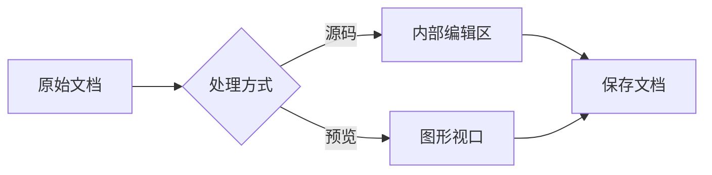
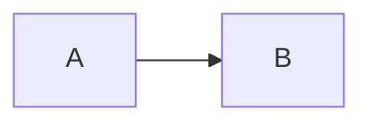
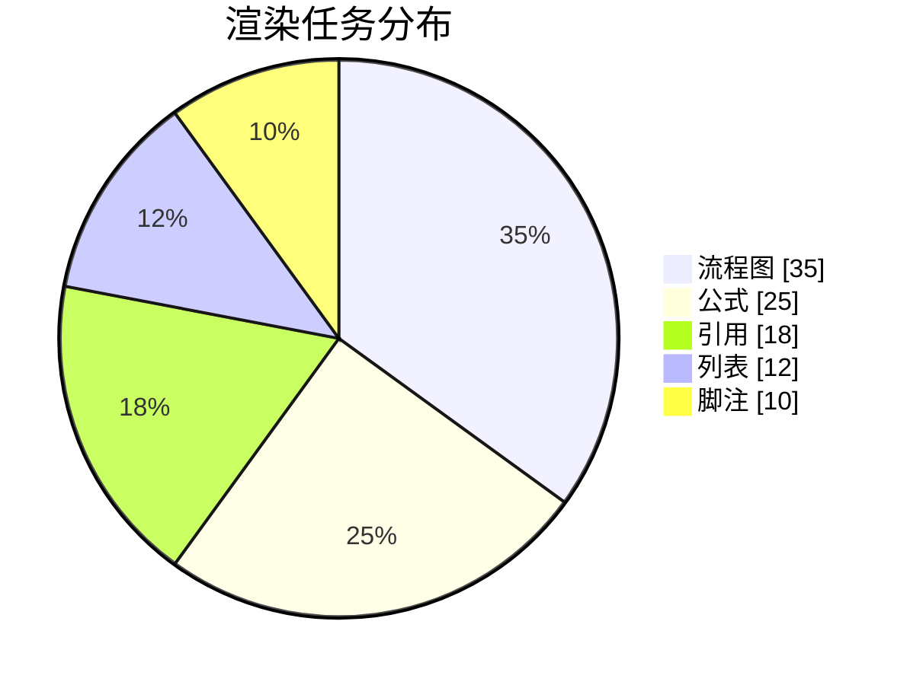

# Mermaid 与公式内部编辑区人工验证

这份文档检查 Mermaid 块内源码与公式主文档源码。Mermaid 依次切换「预览 → 分栏 → 源码」；公式点击或移入光标后显示上方源码、下方即时结果，离开或 Ctrl+Enter 后收起源码。检查四向进入与离开、鼠标、选区、输入、缩进、复制、撤销与重做。公式在 Live / Preview 中 hover 显示复制按钮，无外框、缩放或拖动。深浅主题和窄窗口分别检查一次。

## 相邻块与普通代码对照

前置正文：在这里放置光标并向下移动。

```js
const first = 1;
const second = 2;
```



$$
\begin{aligned}
  f(x) &= \frac{x^2 + 1}{x + 2} \\
  f'(x) &= \frac{x^2 + 4x - 1}{(x + 2)^2}
\end{aligned}
$$

后置正文：检查离开源码后输入是否落在这里，以及撤销是否只撤销刚才的修改。

## 二级列表与空行

- 外层项目
  - 内层项目

    ```mermaid
    flowchart TB
      A[起点] --> B[包含中文及较长文字的节点，用窄窗口检查自动换行和光标落点]

      B --> C[结果]
    ```

    $$
    a = 1

      + b + c
    $$

    同一个列表项目中的后续正文。

## 引用与引用内列表

> 引用中的两个编辑块：Enter 后继续输入，检查新行是否仍留在引用中。
>
> ```mermaid
> sequenceDiagram
>   participant A as 编辑区
>   participant B as 文档
>   participant C as 预览
>   A->>B: 修改源码
>   B->>C: 请求渲染
>   C-->>A: 更新完成
> ```
>
> $$
> x = \frac{a+b}{c+d}
>   + y
> $$
>
> - 引用内的列表
>
>   ```mermaid
>   flowchart LR
>     A --> B --> C
>   ```
>
>   $$
>   E = mc^2
>   $$

## 脚注

带图表和公式的脚注[^blocks]。

[^blocks]: 脚注正文。将光标放到源码行末按 Enter、Tab、Shift+Tab、Backspace，检查空白不会反复增加。

    ```mermaid
    flowchart LR
      A[脚注数据] --> B[分析] --> C[说明]
    ```

    $$
    r = \frac{6}{8} \times 100\% = 75\%
    $$

    脚注中的后续正文。

## 清空、错误与恢复

以下两个块开始时有效。打开分栏后分别全选并删除源码，继续输入，切换源码模式，再重新填入有效内容。检查只存在一个编辑器。



$$
\frac{a}{b}
$$

在 Mermaid 中暂时输入 `A[未完成`，在公式中暂时输入 `\frac{`。源码区应保持可用，补全后右侧恢复预览。

## 多色饼图与缩放



$$
\sum_{i=1}^{n} i = \frac{n(n+1)}{2}
$$

缩放、拖动、重置后，检查图形视口居中、源码框不被无故撑高；滚动到顶部工具栏离开视口后，再使用浮动工具栏。
